# Microbiological surveillance of Kelani River fish

### Original biomedical research · authentic laboratory photographs · reproducible Python reanalysis

This portfolio connects a **documented experimental microbiology project** with a **new computational analysis** of its published aggregate findings. The original study examined presumptive *Staphylococcus*, *Salmonella* and *Shigella* detection at four anatomical sites in 27 fish associated with Sri Lanka's Kelani River. The new code validates reported counts, calculates detection proportions and uncertainty intervals, and creates figures. No new specimens or specimen-level results were created here.

| Research at a glance | |
|---|---|
| Experimental study | Fish sampling, culture, microscopy and biochemical observations documented in the university report. |
| Publication | Five-author conference abstract, printed identifier **PP–137**, page **189**. |
| Computational extension | Source-attributed data, Python validation and statistics, six figures, five executed notebooks and a reanalysis report. |
| Evidence boundary | Published p-values and individual bench roles cannot be independently verified from the supplied aggregate records. |

**Explore:** [Laboratory gallery](#original-laboratory-image-gallery) · [Computational figures](#computational-analysis-and-figures) · [Results](#published-observations) · [Reproduce](#reproduce-the-analysis) · [Project audit](docs/project_audit.md)

The original research began in 2025; the computational portfolio was created in 2026. [Verified research and repository timeline](docs/research_timeline.md)

**Read the reanalysis:** [LaTeX manuscript PDF](reports/computational_reanalysis_latex.pdf) · [Editable LaTeX source](reports/latex/computational_reanalysis.tex) · [Build instructions](reports/latex/README.md) · [Estimates and confidence intervals](data/processed/published_detection_intervals.csv)

## Original research and publication credit

The supplied abstract is titled **“Evidence of Foodborne Pathogen Contamination in Riverine Fish from Kelani River, Sri Lanka: A Public Health Perspective.”** Its printed author order and affiliation markers are **Anpalakan T; Meddage AKMMK¹,²; Liyanage GY²,³; Idroos FS²; Manage PM²***. The printed affiliations are ¹ Faculty of Graduate Studies, University of Sri Jayewardenepura; ² Centre for Water Quality and Algae Research, Department of Zoology, University of Sri Jayewardenepura; and ³ Faculty of Urban Science and Aquatic Bioresources, University of Sri Jayewardenepura. The university proposal and report also identify the Department of Zoology, Faculty of Applied Sciences.

**Tharuniya Anpalakan** is the named candidate and author of the university project report. The report identifies **Senior Professor Pathamalal M. Manage** as principal supervisor and acknowledges **Mr Anjana Kelum** for guidance. The abstract has five authors; this repository preserves their credit and attributes the later computational extension separately to Tharuniya. The complete conference venue, proceedings title, publication year and peer-review status are not verified by the supplied page. [Document inventory](docs/source_inventory.md)

## Experimental Research and Hands-On Wet-Lab Experience

The final report documents fish obtained through local fishermen; skin and mouth swabs; gill and gut tissue sampling; sterile saline suspensions and dilutions; enrichment and selective culture; Gram staining, microscopy and biochemical observations; and research reporting. Original photographs on report pages 14 and 17–19 show the laboratory stages. The PDFs do not identify who performed each photographed procedure, so the techniques below are presented as **study-documented team work**, with individual roles pending confirmation.

### Original laboratory image gallery

These are **unaltered embedded photographs from the university report**. Page and figure numbers refer to the original document. Eight selected images are tracked for **private review** so the README gallery renders. **Confirm photograph redistribution rights before any public release.** The original PDFs remain excluded from Git. [Full 31-image inventory](assets/wet_lab/image_inventory.csv)

| Culture: mannitol salt agar | Culture: Salmonella-Shigella agar |
|---|---|
| 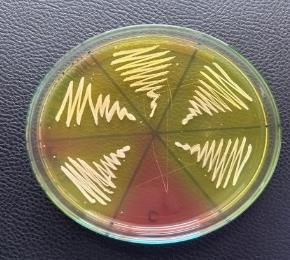<br>**Report p14, Fig. 2.** After incubation in the presumptive *Staphylococcus* workflow. | 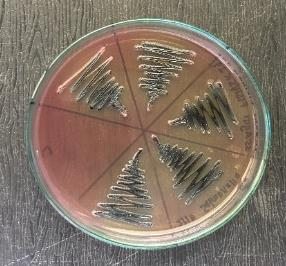<br>**Report p14, Fig. 4.** After incubation in the presumptive *Salmonella* workflow. |
| 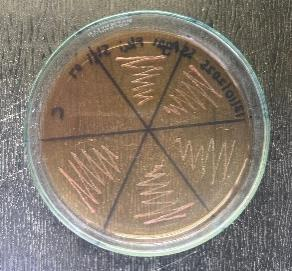<br>**Report p14, Fig. 6.** After incubation in the presumptive *Shigella* workflow. | 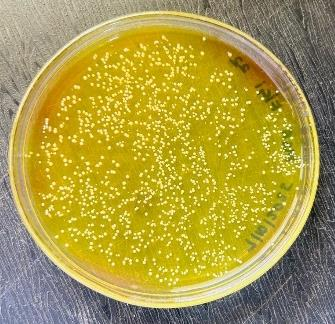<br>**Report p17, Fig. 19.** Mannitol salt agar shown with the biochemical observations. |

| Microscopy | Biochemical tests |
|---|---|
| 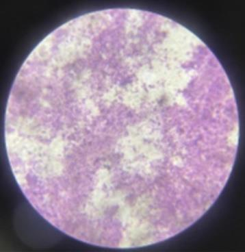<br>**Report p17, Fig. 13.** Suspected *Staphylococcus* microscopic field. | 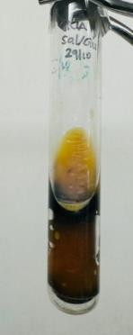<br>**Report p18, Fig. 27.** Kligler iron agar after incubation in the presumptive *Salmonella* workflow. |
| 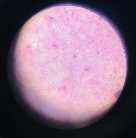<br>**Report p19, Fig. 29.** Suspected *Shigella* microscopic field. | 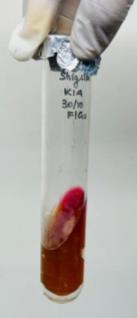<br>**Report p19, Fig. 35.** Kligler iron agar after incubation in the presumptive *Shigella* workflow. |

No field-collection or fish-anatomical-sampling photographs were present in the supplied PDFs. Colony appearance and biochemical reactions document reported observations; they do not independently verify species, virulence or molecular identity.

### Experimental Techniques and Research Competencies

| Study-documented technique | Scientific purpose | Attribution boundary |
|---|---|---|
| Fish collection and skin, mouth, gill and gut sampling | Compare recovery across environmental contact sites and gut material. | Operator for each specimen unrecorded. |
| Saline suspensions, dilutions, enrichment and selective media | Recover presumptive target isolates. | Report method p13; culture images p14. |
| Gram stain, microscopy, catalase, urease, indole and Kligler iron agar | Characterize isolates with morphology and reaction patterns. | Test images pp17–19; individual operator unrecorded. |
| Research writing and dissemination | Record and communicate methods, observations and conclusions. | Tharuniya is the report's named candidate; the abstract has five authors. |

The proposal lists additional **planned** procedures that the final report does not clearly document as completed. [Method and contribution boundaries](docs/methodology.md)

## From wet lab to computational lab

```mermaid
flowchart LR
    A[Fish collection] --> B[Anatomical sampling]
    B --> C[Culture and enrichment]
    C --> D[Presumptive identification]
    D --> E[Experimental observations]
    E --> F[Published aggregate counts]
    F --> G[Validated dataset]
    G --> H[Python analysis]
    H --> I[Figures and interpretation]
```

The first six stages belong to the original experimental research and publication. Dataset validation, new Python analyses, Wilson intervals and this portfolio's figures and report are later additions.

| Computational skill | Reproducible evidence |
|---|---|
| Source transcription and provenance | [Source-attributed CSV](data/processed/organ_detection_summary.csv), [builder](scripts/build_data.py), [reconciliation](docs/source_reconciliation.md) |
| Data quality checks | [Validation module](src/data_processing.py), [automated tests](tests/test_analysis.py) |
| Descriptive analysis and uncertainty | [Summary functions](src/descriptive_analysis.py), [Wilson intervals](src/statistical_analysis.py) |
| Scientific visualization | [Figure generator](src/visualization.py), [figure captions](docs/figure_captions.md) |
| Reproducible reporting | [Five executed notebooks](notebooks/), [LaTeX reanalysis PDF](reports/computational_reanalysis_latex.pdf), [editable manuscript](reports/latex/computational_reanalysis.tex), [data-driven report builder](scripts/build_latex_report.py) |

## Published observations

**Research question:** How do the reported detection frequencies vary across fish anatomical sites, and what can these aggregate data support? The abstract lists *Oreochromis mossambicus*, *O. niloticus*, *Labeo rohita* and *Heteropneustes fossilis*, but supplies no linked fish-by-species outcomes. The report has a different species list. [Source reconciliation](docs/source_reconciliation.md)

| Reported organism group | Skin | Mouth | Gills | Gut |
|---|---:|---:|---:|---:|
| *Staphylococcus* spp. | 27/27 (100.0%) | 27/27 (100.0%) | 15/27 (55.6%) | 22/27 (81.5%) |
| *Salmonella* spp. | 11/27 (40.7%) | 9/27 (33.3%) | 10/27 (37.0%) | 4/27 (14.8%) |
| *Shigella* spp. | 9/27 (33.3%) | 15/27 (55.6%) | 11/27 (40.7%) | 5/27 (18.5%) |

Counts are from the supplied abstract; percentages are recalculated from integers. They describe **detection**, not bacterial concentration or infection risk. [Data dictionary](docs/data_dictionary.md) · [Provenance](docs/data_provenance.md)

## Computational analysis and figures

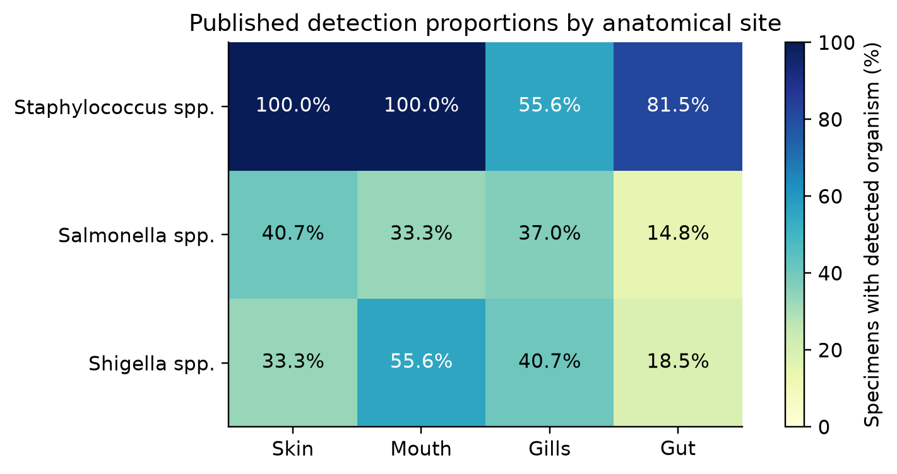

**Figure 1.** Published detection percentages, calculated as positive count divided by the site denominator. Report results independently repeat the 12 abstract counts.

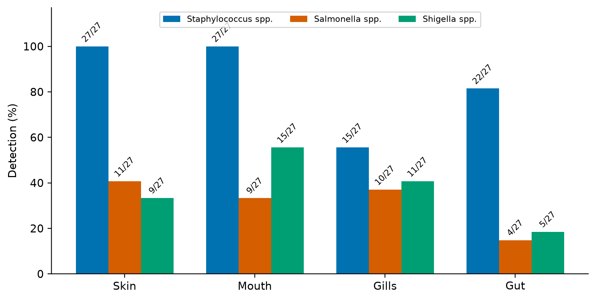

**Figure 2.** Organ-specific detections with exact count labels. A percentage describes positive specimens, not organism concentration.

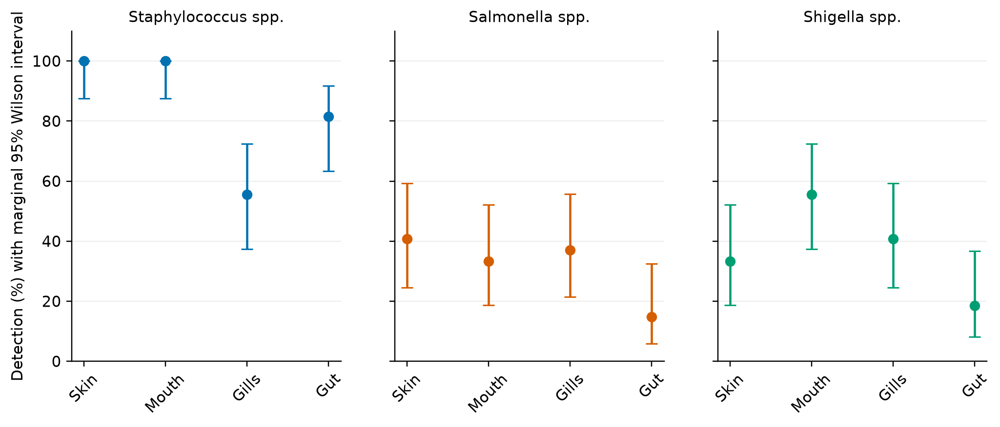

**Figure 3.** Two-sided 95% Wilson intervals for individual marginal proportions. These are **not** intervals for paired site differences.

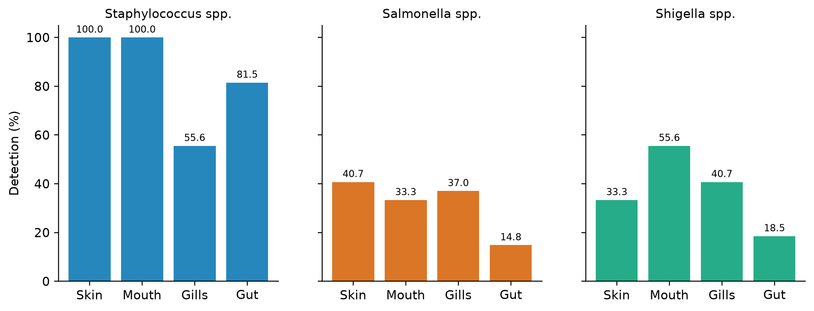

**Figure 4.** Categorical anatomical profiles, shown separately for each organism group. The sites do not form a continuous numerical sequence.

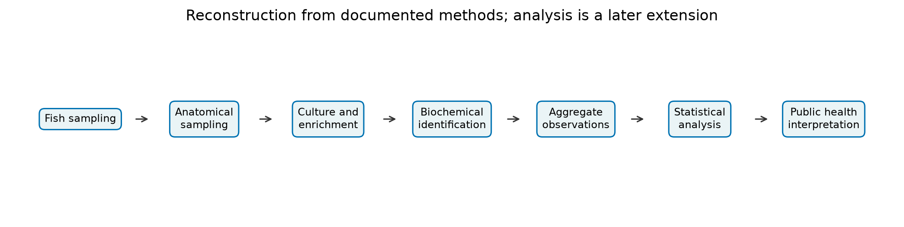

**Figure 5.** A reconstruction of the documented study workflow. The statistical analysis shown here is the later computational extension.

The calculated site range is **44.4 percentage points** for *Staphylococcus*, **37.0** for *Shigella* and **25.9** for *Salmonella*. The abstract reports **p < 0.001 for Staphylococcus, p = 0.17 for Salmonella, and p = 0.041 for Shigella**. Those remain **published claims, not reproduced tests**: multiple sites were sampled on each fish, but linked outcomes and the original test are unavailable. [Statistical limitations](docs/statistical_limitations.md)

### A documented source discrepancy

The report results and abstract agree on **22/27** *Staphylococcus* gut detections (81.48%). The report discussion instead prints **22/25 (81.48%)**; a literal 22/25 equals **88.00%**. Its Shigella discussion also mispairs gill and gut counts with percentages. Every reading remains source-attributed in the dataset; the primary figures use the abstract. [Full reconciliation](docs/source_reconciliation.md)

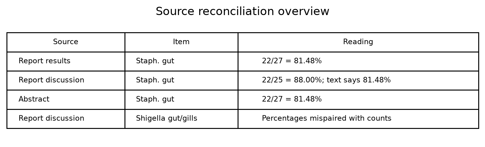

**Figure 6.** Explicit comparison of inconsistent source readings. See the [LaTeX manuscript](reports/computational_reanalysis_latex.pdf) for the full results table, Wilson formula, denominator sensitivity, original laboratory evidence, and interpretation.

## Reproduce the analysis

Tested with Python 3.14.2 on Windows. The original PDFs remain local and outside Git for privacy and rights review.

```powershell
python -m venv .venv
.venv\Scripts\Activate.ps1
python -m pip install -r requirements.txt
python -m scripts.build_data
python -m src.visualization
python -m pytest -q
python -m scripts.build_notebooks
python -m scripts.build_report
```

For the typeset LaTeX manuscript, install **MiKTeX or TeX Live** with `pdflatex`, then run:

```powershell
python -m scripts.build_latex_report
```

This generates the numerical tables and figures from validated data, compiles the manuscript twice, and exports `reports/computational_reanalysis_latex.pdf`. The earlier compact Markdown-based report remains available as `reports/computational_reanalysis.pdf`.

[Detailed reproducibility notes](docs/reproducibility.md)

## Citation, rights and acknowledgements

**Original abstract:** Anpalakan T; Meddage AKMMK; Liyanage GY; Idroos FS; Manage PM. “Evidence of Foodborne Pathogen Contamination in Riverine Fish from Kelani River, Sri Lanka: A Public Health Perspective.” Supplied abstract, PP–137, p. 189. A complete venue/year citation needs verification.

**New software and report:** Tharuniya Anpalakan, *Kelani River fish microbiology: aggregate-data computational reanalysis*, version 0.1.0 (2026). [Software citation metadata](CITATION.cff). The MIT license applies to new Python software, not the original publication or photographs.

The university proposal, final report and abstract remain unchanged locally and outside Git. The eight selected photographs are tracked **for private review only**; obtain redistribution clearance before any public release. The original report contains private identifiers requiring review before release. The project acknowledges Senior Professor Pathamalal M. Manage, Mr Anjana Kelum, the Department of Zoology, Faculty of Applied Sciences, the Centre for Water Quality and Algae Research, and all original coauthors. AI assistance supported code and editorial drafting. [Project audit and release conditions](docs/project_audit.md)
