# Kelani River fish microbiology: published research and computational reanalysis

**Experimental biomedical research, followed by a reproducible analysis of published aggregate findings.** The original study examined culture-based detection of presumptive *Staphylococcus*, *Salmonella* and *Shigella* across skin, mouth, gills and gut samples from 27 fish associated with Sri Lanka's Kelani River. This repository digitizes the reported counts, reconciles source discrepancies, calculates detection percentages and marginal uncertainty intervals, and generates new figures. It does not introduce new specimens or claim to reproduce the original inferential tests.

## Original research and publication

The supplied one-page abstract is titled **“Evidence of Foodborne Pathogen Contamination in Riverine Fish from Kelani River, Sri Lanka: A Public Health Perspective”**, printed as **PP–137, p. 189**. Its author line reads **Anpalakan T; Meddage AKMMK¹,²; Liyanage GY²,³; Idroos FS²; Manage PM²***. The printed affiliation mapping is: ¹ Faculty of Graduate Studies, University of Sri Jayewardenepura; ² Centre for Water Quality and Algae Research, Department of Zoology, University of Sri Jayewardenepura; ³ Faculty of Urban Science and Aquatic Bioresources, University of Sri Jayewardenepura. The original university proposal and report also name the Department of Zoology, Faculty of Applied Sciences. The complete conference venue, proceedings title, publication year and peer-review status remain unverified from the supplied page; no DOI is asserted. [Source inventory](docs/source_inventory.md).

Tharuniya Anpalakan is the named candidate and author of the university project report. The five named authors receive full credit for the conference abstract. The final report names **Senior Professor Pathamalal M. Manage** as principal supervisor and thanks **Mr Anjana Kelum** for guidance. This computational extension is attributed separately to Tharuniya Anpalakan; it does not revise the original publication's authorship.

### Experimental Research and Hands-On Wet-Lab Experience

The university report records a complete experimental workflow: fish obtained through local fishermen; skin and mouth swabs and gut and gill tissue sampling; sterile saline suspensions and dilutions; enrichment and selective culture; observation of colony appearance; Gram staining, microscopy and biochemical tests; and reporting of 27 fish-level detection summaries. Photographs on report pp14 and 17–19 show the culture, stain and test stages. Tharuniya is documented as the candidate who authored/submitted the report and acknowledged the laboratory support. The PDFs do not identify the operator of each photographed procedure, so individual bench techniques are presented as **study-documented team work**, pending confirmation of personal roles. The publication is a later five-author summary of the experimental work.

**Original laboratory image gallery (local source review; redistribution pending).** The following are original embedded images extracted without pixel editing from the report. They are excluded from Git until the rights holder authorizes redistribution. Relative links work in this local workspace; they will require permission and inclusion before public GitHub rendering. [Full image inventory](assets/wet_lab/image_inventory.csv).

| Study stage | Original figure and caption |
|---|---|
| Selective culture | <br>Report p14, Figure 2: mannitol salt agar after incubation. |
| Selective culture | <br>Report p14, Figure 4: Salmonella-Shigella agar after incubation. |
| Microscopy | <br>Report p17, Figure 13: microscopic field of a suspected *Staphylococcus* isolate. |
| Biochemical test | <br>Report p18, Figure 27: Kligler iron agar after incubation of a suspected *Salmonella* isolate. |

No original field collection photograph or fish anatomical sampling photograph was present in the supplied PDFs. The gallery shows documented procedures, not independent molecular or species-level confirmation.

### Experimental Techniques and Research Competencies

| Evidence level | Technique and purpose |
|---|---|
| Study documented; individual operator unverified | Fish collection and aseptic anatomical sampling to compare environmental contact surfaces and gut material. |
| Study documented; individual operator unverified | Saline suspensions, dilutions, enrichment and selective media to recover presumptive target organisms. |
| Study documented and photographed; individual operator unverified | Gram stain, microscopy, catalase, urease, indole and Kligler iron agar observations to characterize isolates. |
| Directly documented contribution | Tharuniya prepared the named university research project report and communicated the findings in a coauthored conference abstract. |
| New computational contribution | Source transcription, data validation, Wilson intervals, reproducible Python charts and report preparation. |

The proposal lists some additional planned tests; [the methods audit](docs/methodology.md) separates these from procedures documented in the final report. The genus labels are reported findings from the study, with the identification limits described below.

### Experimental-to-computational workflow

```mermaid
flowchart LR
    A[Fish sampling] --> B[Laboratory processing]
    B --> C[Culture and enrichment]
    C --> D[Presumptive identification]
    D --> E[Experimental observations]
    E --> F[Published aggregate counts]
    F --> G[Structured dataset]
    G --> H[Python analysis]
    H --> I[Statistical interpretation]
    I --> J[Computational reanalysis report]
```



Steps through aggregate observations belong to the original experimental study. Dataset structuring, new Python analysis, Wilson intervals and this computational report were added for the repository. The original conference abstract published the aggregate findings. [Detailed method boundaries](docs/methodology.md).

## Research question and data

How do the **reported detection frequencies** vary across fish anatomical sites, and what can be concluded from aggregate marginals? The published abstract lists *Oreochromis mossambicus*, *O. niloticus*, *Labeo rohita* and *Heteropneustes fossilis*, but it gives no fish-by-species/site records. The final report's species list differs; see [reconciliation](docs/source_reconciliation.md). No specimen-level dataset or site map is manufactured.

| Group | Skin | Mouth | Gills | Gut |
|---|---:|---:|---:|---:|
| *Staphylococcus* spp. | 27/27 (100.0%) | 27/27 (100.0%) | 15/27 (55.6%) | 22/27 (81.5%) |
| *Salmonella* spp. | 11/27 (40.7%) | 9/27 (33.3%) | 10/27 (37.0%) | 4/27 (14.8%) |
| *Shigella* spp. | 9/27 (33.3%) | 15/27 (55.6%) | 11/27 (40.7%) | 5/27 (18.5%) |

Counts are taken from the supplied abstract; percentages here are recalculated from integers and may differ slightly from rounded source wording. [Data dictionary](docs/data_dictionary.md) · [Provenance](docs/data_provenance.md).

## New analysis and scientific interpretation

The largest reported site range is *Staphylococcus* (100.0% versus 55.6%, **44.4 percentage points**), followed by *Shigella* (55.6% versus 18.5%, **37.0 points**) and *Salmonella* (40.7% versus 14.8%, **25.9 points**). These are descriptive contrasts. The figure below uses 95% Wilson intervals for each marginal proportion; it does not quantify paired differences.


Additional [grouped bars](figures/02_grouped_bars.png), [site profiles](figures/04_detection_profiles.png), [workflow reconstruction](figures/05_workflow.png), and [source comparison](figures/06_source_comparison.png) are generated by code. [Figure captions](docs/figure_captions.md).

The abstract reports p-values of <0.001, 0.17 and 0.041 for *Staphylococcus*, *Salmonella* and *Shigella*, respectively. The original test, linked fish outcomes and code are unavailable, so those p-values are **reported, not independently reproduced**. Repeated sites on each fish require paired or clustered analysis. Marginal totals alone cannot reconstruct Cochran's Q or McNemar tests. Culture and biochemical patterns also do not verify species, virulence or infection risk. [Statistical limitations](docs/statistical_limitations.md).

## Source discrepancy

The report results and abstract agree on 22/27 *Staphylococcus* gut detections; the report discussion prints `22/25 (81.48%)`. A literal 22/25 equals 88.0%. Its Shigella discussion also attaches the wrong percentages to gut and gill counts. All readings are retained with provenance in the CSV; the primary figures use the abstract. The 22/25 sensitivity differs by **6.52 percentage points**. [Full reconciliation](docs/source_reconciliation.md).

## Reproduce the computational work

Use Python 3.11+; the tested environment was Python 3.14.2 on Windows. With the source PDFs held privately, the committed transcription still supports a fresh-clone computational run.

```powershell
python -m venv .venv
.venv\Scripts\Activate.ps1
python -m pip install -r requirements.txt
python -m scripts.build_data
python -m src.visualization
python -m pytest -q
python -m scripts.build_notebooks
python -m scripts.build_report
```

The modules live in `src/`; `scripts/` builds the data, notebooks, figures and report. Derived data are in `data/processed/`; figures in `figures/`; five executed notebooks in `notebooks/`; a new [PDF report](reports/computational_reanalysis.pdf) and editable report source are in `reports/`. Source-specific background, methods, audit and captions are in `docs/`. [Full reproducibility notes](docs/reproducibility.md).

## Citation, rights and acknowledgements

**Original research:** Anpalakan T; Meddage AKMMK; Liyanage GY; Idroos FS; Manage PM. “Evidence of Foodborne Pathogen Contamination in Riverine Fish from Kelani River, Sri Lanka: A Public Health Perspective.” Supplied conference abstract, PP–137, p. 189. Full bibliographic venue/year unverified. Cite the original only with verified metadata.

**New software and report:** Tharuniya Anpalakan, *Kelani River fish microbiology: aggregate-data computational reanalysis* (2026), version 0.1.0; [CITATION.cff](CITATION.cff). This repository's Python software is MIT licensed; original PDFs, photographs and third-party material are outside that grant. The original university documents and abstract remain unchanged locally and excluded from Git pending privacy and redistribution review. Research preparation used AI assistance for code and editorial drafting; scientific claims remain tied to supplied sources and the listed references.

The project acknowledges Senior Professor Pathamalal M. Manage, Mr Anjana Kelum, the Department of Zoology, Faculty of Applied Sciences, the Centre for Water Quality and Algae Research, and all original coauthors. See [project audit](docs/project_audit.md) for remaining publication checks.
